# AwayTerminal

**專為「用 AI agent 寫程式」設計的分頁式終端機**，支援 Windows、macOS 與 Linux。

[English](README.en.md)　|　授權 MIT　|　下載：<https://www.awaysu.cc/software/awayterminal>

---

## 給 AI 開發用的

- **一鍵開 AI CLI**：Claude Code、Codex、OpenCode、Antigravity、Grok 等，自動偵測這台已安裝的工具。
- **代理團隊**：用不同的 AI agent 搭配 2～4 個 AI 角色（PM、工程師、QA…）在同一視窗分格協作。
- **AI 聊天室**：用不同的 AI agent 搭配 2～4 個 AI 角色輪流討論一個題目，主持人收尾寫結論。
- **Telegram 遠端**：手機上看畫面、下指令、任務完成推播。
- **GitHub 倉庫列表**：直接下載 repo，下指令讓 AI agent 編輯。
- **忙碌提示**：忙碌中的分頁與工作列圖示會標紅圈，可先縮小視窗去做別的事。
- **使用額度**：右上角即時顯示 Claude Code 與 Codex 的使用額度。

## 一般終端機功能

- 本機 shell、內建 SSH（PuTTY 風格、`.ppk`、自動重連）、Telnet、序列埠、WSL、ADB。
- 分頁／分割／分欄、搜尋、log 記錄、我的最愛、恢復分頁含畫面倒回、八種介面語言。
- 相容 TeraTerm 的 TTL 巨集。

---

## 畫面

### AI CLI 與忙碌提示

支援 Claude Code、Codex、OpenCode、Antigravity、Grok 等。忙碌中的分頁與工作列圖示會標紅圈，可先縮小視窗去做別的事；右上角即時顯示 Claude Code 與 Codex 的使用額度。

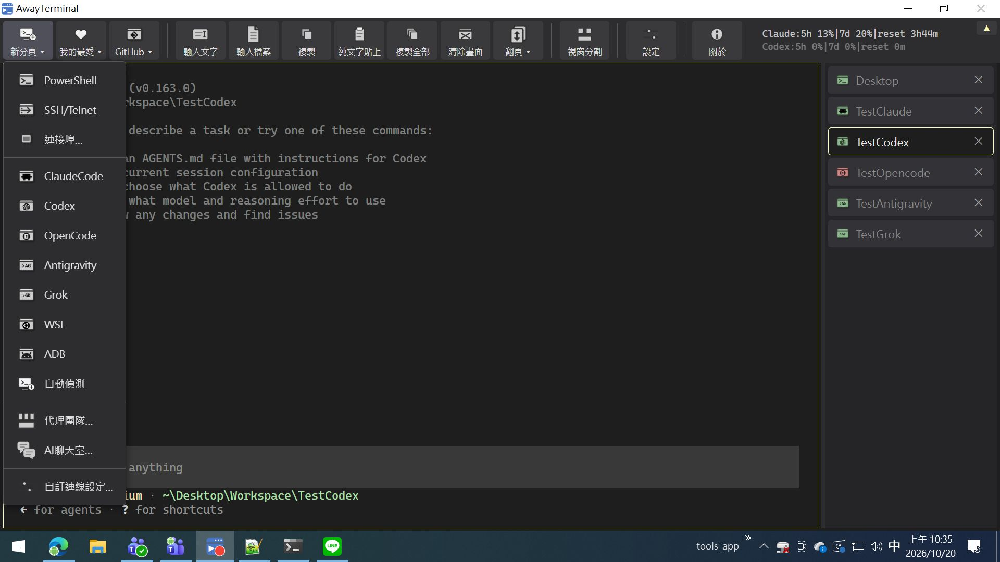

### 代理團隊

用不同的 AI agent 搭配 2～4 個 AI 角色，在同一視窗分格協作；agent 之間靠專案裡的 `.ai/bus/` 信箱互相傳訊。

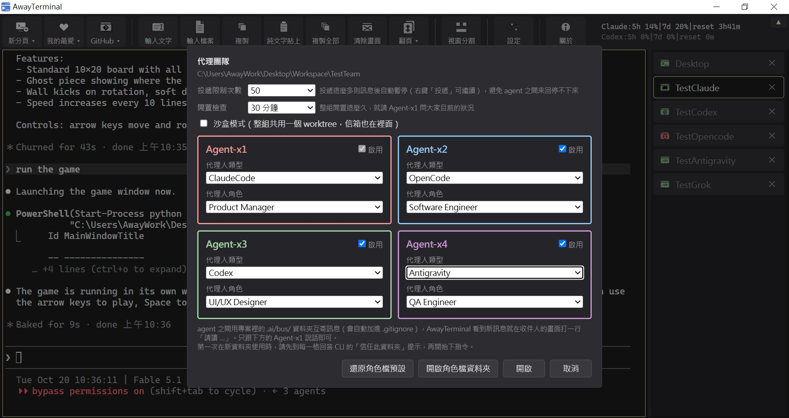
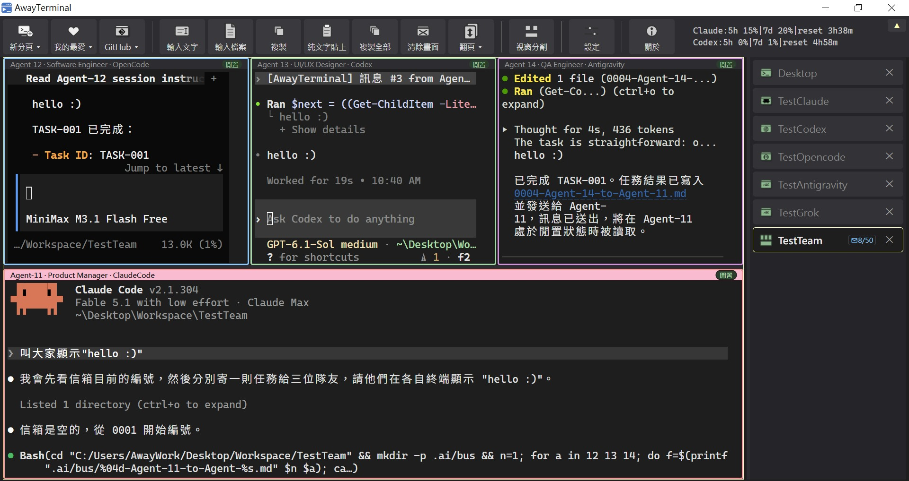

### AI 聊天室

用不同的 AI agent 搭配 2～4 個 AI 角色輪流討論一個題目，主持人收尾寫結論。

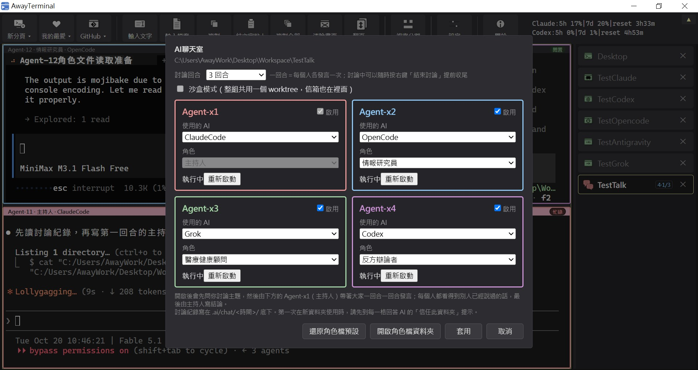
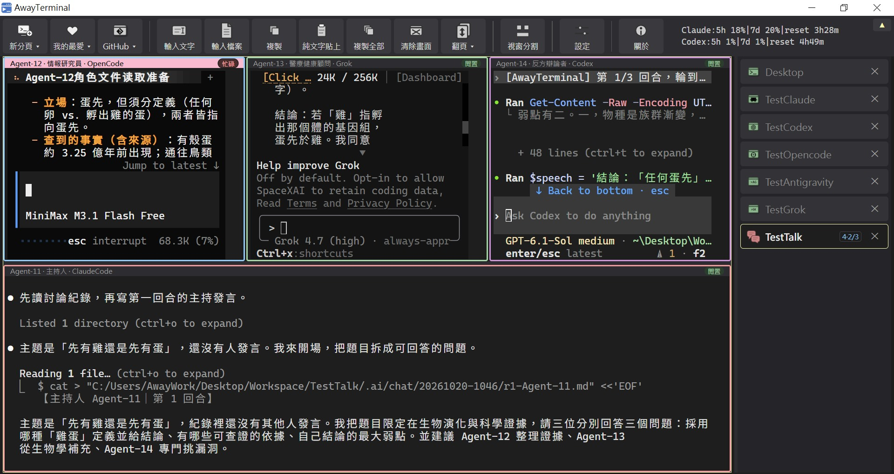

### Telegram 遠端

在設定裡填 bot token 與 chat ID，手機上就能看畫面、下指令，任務完成會推播通知。

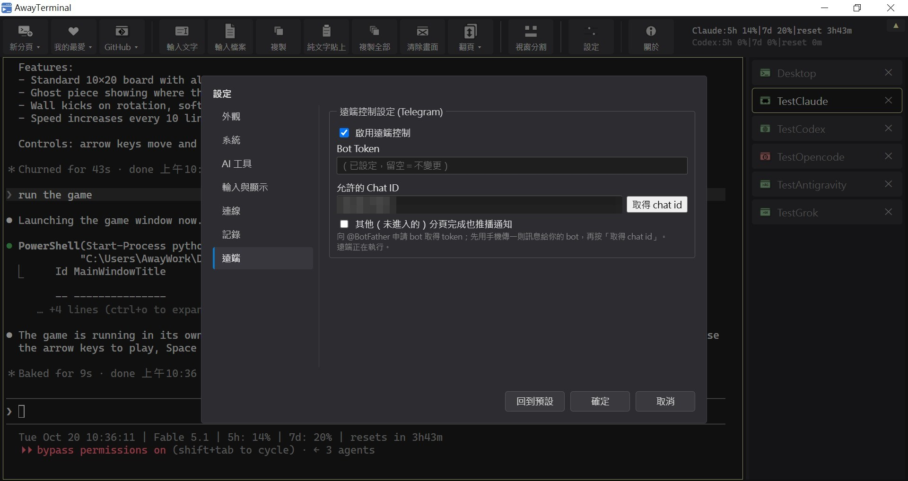
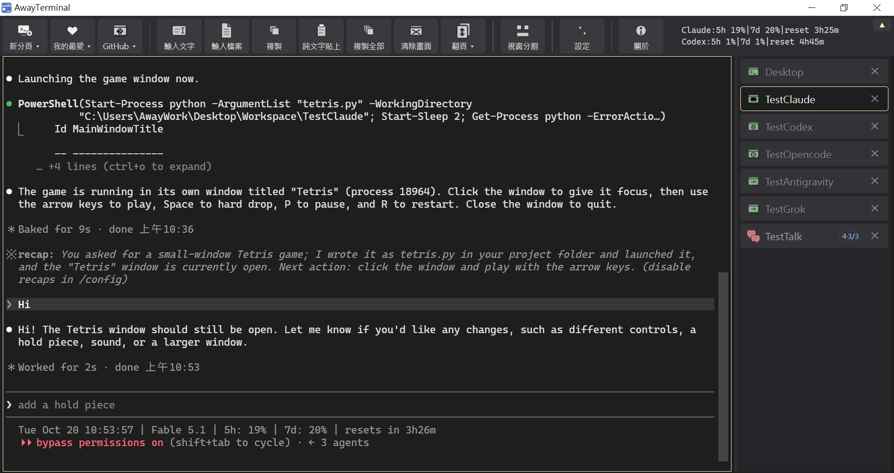
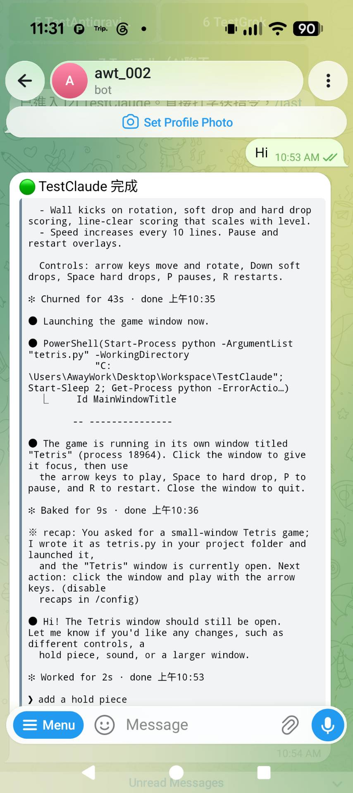

### GitHub 倉庫列表

列出自己的 repo（含私人），選一個直接下載，再交給 AI agent 編輯。

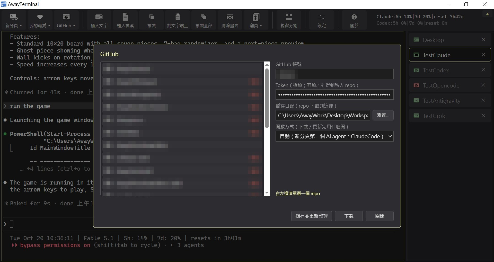

### 輸入文字

可輸入多行文字，或載入已經寫好的 prompt 文字檔，一次送進 AI CLI。

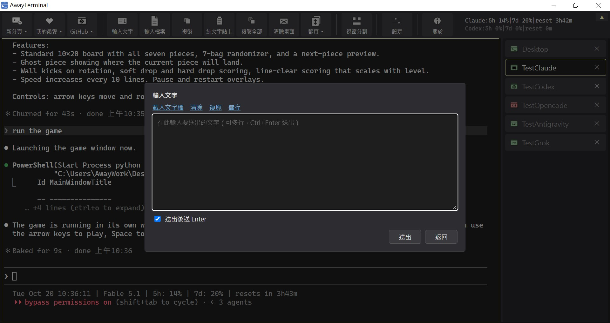

### macOS 與 Linux

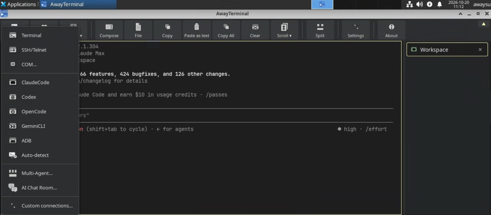
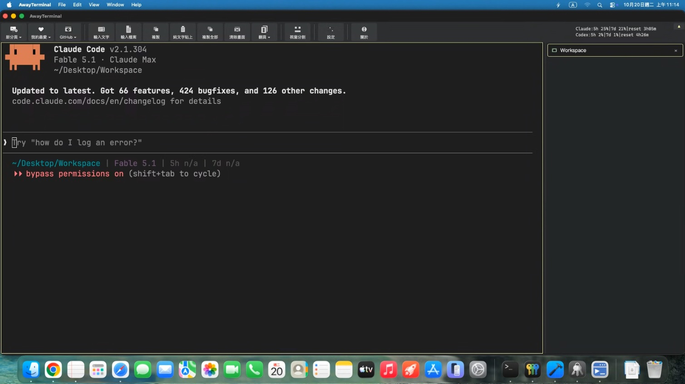

---

## 從原始碼建置

需要 Rust（1.89+）、Node 20+、以及各平台的 webview 開發套件。
完整步驟、常見問題與目錄結構在 **[docs/DEV-SETUP.md](docs/DEV-SETUP.md)**。

```bash
npm ci
npm run tauri dev      # 開發
npm run tauri build    # 產生安裝檔
```

常用的檢查（發佈前全部要過，清單在 [docs/RELEASE.md](docs/RELEASE.md)）：

```bash
cd src-tauri && cargo test --lib && cargo clippy --all-targets -- -D warnings
cd .. && node scripts/test-i18n.mjs        # 八語沒有缺漏
node scripts/i18n-audit.mjs                # 沒有漏掉的中文字串
node scripts/test-bridge-args.mjs          # session_create 的參數都有傳到
npm run verify                             # 端到端（開視窗、跑完自己關掉）
npm run verify:release                     # 同上，但用 release 的 exe
```

---

## 文件

### 規格與架構

| 文件 | 內容 |
|---|---|
| [CLAUDE.md](CLAUDE.md) | **這個專案的規格書**：目標、技術選型、平台差異、風險、階段計畫 |
| [docs/DEV-SETUP.md](docs/DEV-SETUP.md) | 開發環境、建置、目錄結構、踩過的環境雷、**行尾規則** |
| [docs/PROTOCOL.md](docs/PROTOCOL.md) | `terminal.js` ↔ host 的 31 個舊協定字串（31/31 都接上了） |
| [docs/TERMINAL-JS-DIFF.md](docs/TERMINAL-JS-DIFF.md) | `terminal.js` 與舊版的**四處**差異，以及沿用的 IME／貼上踩雷修正 |
| [docs/SETTINGS.md](docs/SETTINGS.md) | `settings.json` 每個欄位、哪些是舊版就有的 |

### 功能

| 文件 | 內容 |
|---|---|
| [docs/SSH.md](docs/SSH.md) | 內建 SSH：PuTTY 行為對照、演算法順序、待真機驗證的設備清單 |
| [docs/TELNET.md](docs/TELNET.md) | Telnet 的選項協商與 NAWS |
| [docs/COM.md](docs/COM.md) | 連接埠；`serialport` 不支援的組合怎麼降級 |
| [docs/TTL.md](docs/TTL.md) | TTL 巨集：已實作的指令、與 TeraTerm 原碼的對照 |
| [docs/TTL-TODO.md](docs/TTL-TODO.md) | 還沒做的保留字，**每一條都寫為什麼** |
| [docs/TTL-REGEX.md](docs/TTL-REGEX.md) | Oniguruma vs `fancy-regex` 的實測對照表 |
| [docs/COMPOSE.md](docs/COMPOSE.md) | 輸入文字視窗（Big5 載入、送出後 Enter） |
| [docs/MULTI-AGENT.md](docs/MULTI-AGENT.md) | 代理團隊：信箱格式、投遞時機、節流 |
| [docs/CHATROOM.md](docs/CHATROOM.md) | AI 聊天室：21 個角色、討論流程、紀錄格式 |
| [docs/AGENT-SANDBOX.md](docs/AGENT-SANDBOX.md) | 沙盒模式三層、**已知漏洞**、桌面隔離的選項 |
| [docs/TELEGRAM.md](docs/TELEGRAM.md) | Telegram 遠端：指令、完成推播規則、雜訊過濾、截圖 |
| [docs/WINDOWS-INTEGRATION.md](docs/WINDOWS-INTEGRATION.md) | WSL／ADB 分頁、檔案總管右鍵選單、單一執行個體 |
| [docs/MIGRATION.md](docs/MIGRATION.md) | 匯入舊版設定的對照表與跳過的欄位 |

### 平台

| 文件 | 內容 |
|---|---|
| [docs/PLATFORM-UNIX.md](docs/PLATFORM-UNIX.md) | **mac／Linux：已寫好什麼、待真機驗證什麼、第一天要跑什麼** |
| [docs/IME-LAB.md](docs/IME-LAB.md) | IME 事件錄影頁與九項劇本（跨引擎比對用） |
| [platform/macos/README.md](platform/macos/README.md) | Finder Quick Action 的建立步驟 |
| [platform/linux/](platform/linux/) | Nautilus 腳本與 Dolphin ServiceMenu |

### 測試與發佈

| 文件 | 內容 |
|---|---|
| [docs/SECURITY.md](docs/SECURITY.md) | **安全說明**（給使用者）：token 明文存放、沙盒是防呆不是防壞、SSH 的 Ed25519 建議、回報漏洞的方式 |
| [docs/REGRESSION-CHECKLIST.md](docs/REGRESSION-CHECKLIST.md) | **逐項回歸清單**（自動與 👤 手動），含「刻意與舊版不同」與「隱含契約」兩張表 |
| [docs/MANUAL-TEST-PLAN.md](docs/MANUAL-TEST-PLAN.md) | 上面那份的 👤 條目排成 P0／P1／P2，每節 20～30 分鐘（**從清單產生**） |
| [docs/RELEASE.md](docs/RELEASE.md) | 發佈流程、簽章、updater、檢查清單 |
| [docs/BENCHMARK.md](docs/BENCHMARK.md) | 新舊版怎麼量（啟動、吞吐、記憶體） |
| [docs/IPC-BENCH.md](docs/IPC-BENCH.md) | Tauri IPC 三種傳法的實測（二進位 channel 快 3.4 倍） |
| [CHANGELOG.md](CHANGELOG.md) | 2.0.0 相對 1.2.8 的變更 |

---

## 授權

本專案採 **MIT**（見 [LICENSE](LICENSE)）。

用到的第三方元件包含 MIT、Apache-2.0、BSD-3-Clause、MPL-2.0 等授權
（`russh` 是 Apache-2.0、`serialport-rs` 是 MPL-2.0、TeraTerm 的 `ttpmacro` 是 BSD-3-Clause），
全部的授權全文與出處在 **[THIRD-PARTY-NOTICES.md](THIRD-PARTY-NOTICES.md)**，
安裝檔也會把它裝進程式目錄。

行為參考的來源：[PuTTY](https://www.chiark.greenend.org.uk/~sgtatham/putty/)（SSH 的使用流程）、
[TeraTerm](https://github.com/TeraTermProject/teraterm)（TTL 巨集）、
[microsoft/terminal](https://github.com/microsoft/terminal)（ConPTY 與 OpenConsole）。
